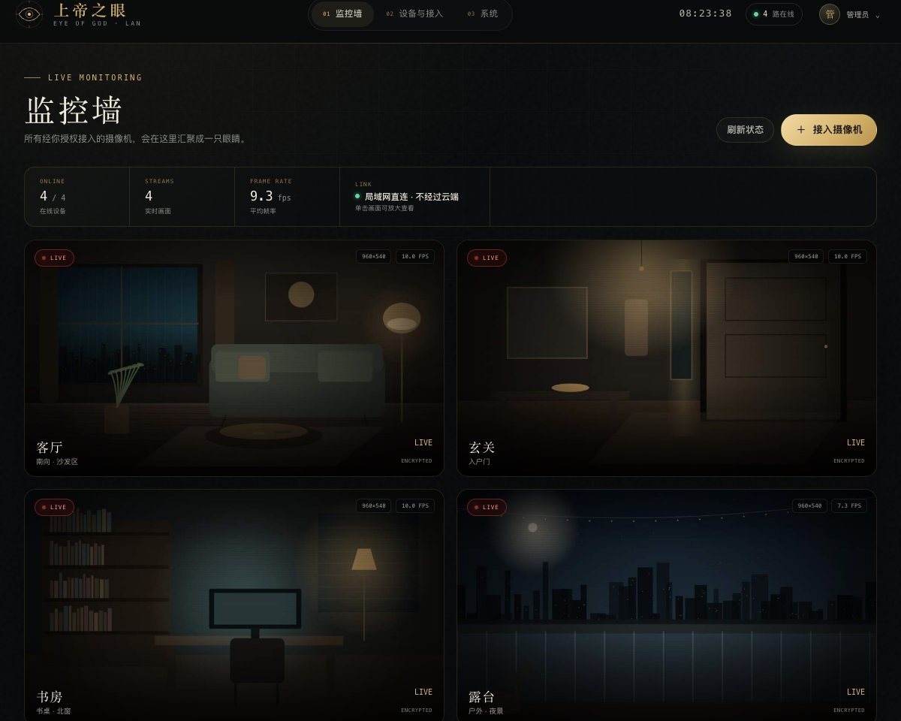
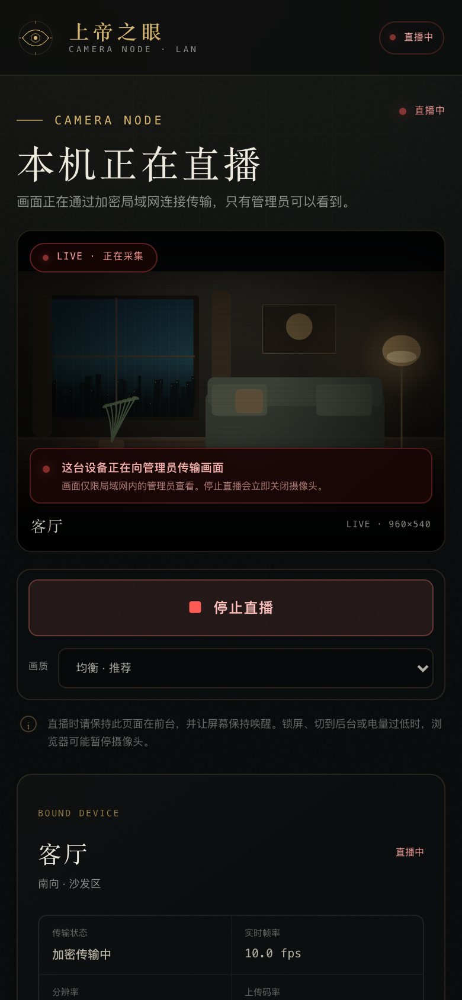

# 上帝之眼 · EYE OF GOD

**当前版本：0.1.0** · [GitHub 仓库](https://github.com/likeweixue/eyeofgod)

> 私有局域网多设备监控墙。手机 / iPad 的浏览器主动开启摄像头，把画面加密传输到这台 Mac；另一台设备打开管理员监控墙，就能同时看到所有经授权的画面。

不经过云端，不需要公网，不录屏，不采集麦克风。画面只在你的局域网里流动。

> [!CAUTION]
> **严禁将本项目用于任何违法或侵犯他人隐私的行为，尤其是偷拍。**
>
> 包括但不限于：偷拍、偷窥、在浴室 / 卧室 / 更衣室等私密场所进行未经同意的拍摄、秘密监控他人、非法传播或出售监控画面。
>
> 本项目仅允许用于**你拥有或已获得明确、知情同意的设备和场所**。使用者必须自行遵守所在国家或地区的法律法规。因滥用造成的法律责任由使用者自行承担，作者不承担任何责任。
>
> **Do not use this project for illegal surveillance, voyeurism, or any non-consensual recording.**

---

## 界面预览

> 以下两张图是界面预览。画面来自为截图专门合成的演示场景（非真实摄像头内容），只用于展示布局与状态。





---

## 它长什么样

- **监控墙**：多路视频同时显示，支持单击放大、全屏、保存当前画面、远程停止某一路直播。
- **摄像机端**：手机 / iPad 用浏览器打开，输入一次性接入码，明确按下“开始直播”后才开启摄像头，页面始终显示红色直播状态。
- **管理端**：密码登录、设备管理、生成扫码即用的接入二维码、查看最近事件。
- **本地 HTTPS**：内置私有 CA，手机安装并信任一次后，浏览器才允许网页调用摄像头。
- **纯局域网**：服务拒绝公网来源地址，不使用云服务，不依赖任何外部 CDN 或字体。

技术栈：**Node.js（原生 HTTP/HTTPS + `ws`）+ 原生 HTML/CSS/JavaScript**。  
视频传输采用 **WebSocket + JPEG 帧**，兼容 iPhone/iPad 的 Safari，管理端用 Canvas 实时渲染多路画面。

> 为什么不用 WebRTC？在这个规模下（家庭 / 小工作室，几路画面、一个管理员），JPEG 帧方案的信令、重连、多路渲染都更简单可靠，iOS 兼容性也最好。代价是延迟略高于 WebRTC，带宽也偏高；局域网环境下完全可接受。

---

## 快速开始

### 0. 前提

- macOS，已安装 **Node.js 20 或更高版本**。
- Mac 和手机 / iPad 连接**同一个 Wi-Fi / 局域网**。
- 首次运行 macOS 若询问是否允许 `node` 接受传入网络连接，请选择**允许**。

### 1. 启动服务

双击项目根目录的 **`start.command`**。

终端会显示类似：

```text
◉  上帝之眼  EYE OF GOD
─────────────────────────────────────────────
① 证书安装  http://192.168.9.107:8080/trust
② 管理端    https://192.168.9.107:8443
③ 摄像机端  https://192.168.9.107:8443/capture

┌─ 首次初始化 ─────────────────────────────┐
│  初始化码：8ZMBUL                        │
└──────────────────────────────────────────┘
```

**记下这个初始化码。** 它只显示在终端里，服务重启后会重新生成。

> 不要关闭这个终端窗口。关闭窗口 = 停止服务。可以把窗口最小化。

### 2. 先安装并信任本地证书

浏览器只允许 HTTPS 页面调用摄像头，而局域网 IP 没有公网证书，所以系统会生成一张只属于你这台 Mac 的根证书。

**在 Mac 上（管理端也需要）：**

最简单的方式：双击项目根目录的 **`install-mac-certificate.command`**，按提示授权一次。

手动方式：

1. 打开 `http://<你的局域网 IP>:8080/trust`。
2. 下载“Mac 证书”，双击加入“登录”钥匙串。
3. 在“钥匙串访问”里找到 **God's Eye Local CA** → 双击 → 展开“信任” → “使用此证书时”设为**始终信任**。
4. 输入 Mac 密码确认。

**在 iPhone / iPad 上：**

1. 用 **Safari** 打开同一个证书安装页（配对弹窗里的 **STEP 01 二维码** 就是它）。
2. 点击“安装 iOS 描述文件”，允许下载。
3. 打开 `设置 → 通用 → VPN 与设备管理`，安装“上帝之眼 本地根证书”。
4. 打开 `设置 → 通用 → 关于本机 → 证书信任设置`，为 **God's Eye Local CA** 打开完全信任。
5. 回到 Safari。

**在 Android 上：**

1. 用 Chrome 打开证书安装页。
2. 下载 `.crt` 证书。
3. 打开 `设置 → 安全 → 加密与凭据 → 安装证书 → CA 证书`，选择刚下载的文件。
4. 不同品牌菜单名称略有不同。

> 安装证书这一步只需要做一次。以后 Mac 的 IP 变了，服务会用同一张 CA 重新签发服务器证书，手机不需要重新安装。
>
> 不安装证书也能“强行继续”打开页面，但 **WebSocket 实时通道通常会被浏览器拒绝**，监控墙会一直显示“正在重连”。请务必完成信任设置。

### 3. 初始化管理员

1. 打开终端里显示的 **管理端** `https://<IP>:8443`。
2. 输入终端里的 6 位初始化码。
3. 设置管理员密码（至少 8 位，建议 12 位以上）。
4. 进入监控墙。

如果初始化码弄丢了：在终端按 `Ctrl+C` 停止服务，重新双击 `start.command`，会生成新的初始化码。

### 4. 接入第一台摄像机

1. 在管理端点击 **“＋ 接入摄像机”**，填写名称。
2. 弹窗会出现 6 位一次性接入码和两个二维码：
   - **STEP 01**：证书安装页（首次使用）。
   - **STEP 02**：摄像机页，接入码已经自动写进二维码链接。
3. 用手机 / iPad 扫码。
4. 在摄像机页点击 **“开始直播”**，允许摄像头权限。
5. 管理端监控墙就会出现实时画面。

摄像机端会一直显示：

> **LIVE · 正在采集** / “这台设备正在向管理员传输画面”

没有任何隐藏启动。停止直播会立即关闭摄像头轨道；管理员也可以远程停止。

---

## 使用说明

### 日常启动

- 双击 `start.command`。
- 打开管理端地址，用管理员密码登录。
- 已配对的手机打开 `https://<IP>:8443/capture`，点“开始直播”即可，不需要重新输入接入码（30 天内有效）。

### 重新绑定 / 更换手机

在“设备与接入”里点某台设备的 **“接入码”**，生成新码，用新手机接入。旧设备会被立即断开，旧 cookie 失效。

### 管理员远程停止

监控墙放大某一路 → “停止这台直播”；或在设备列表点“停止直播”。手机会立刻关闭摄像头，并显示被管理员停止的提示。

### 撤销 / 移除摄像机

设备列表里点“移除”。会同时删除该设备的配对和画面缓存。旧设备无法再连接。

### 快照

监控墙小窗右下角的 `↓`，或播放器里的“保存当前画面”，会把当前 Canvas 保存为 `.jpg`。不会录制连续视频。

### 修改管理员密码

右上角管理员菜单 → “修改管理员密码”，或“系统”页。修改后，其他设备上的管理员会话立即失效。

---

## 安全设计

- **传输**：HTTPS / WSS，使用本机生成的 RSA 证书；CA 私钥保存在 `certs/`，权限 `600`。
- **访问范围**：只接受回环、RFC1918 私有地址、链路本地和 Tailscale CGNAT 地址的请求；拒绝公网来源。**不要**在路由器上做端口转发。
- **Host 校验**：只接受本机 IP、主机名、`.local` 名和 localhost，降低 DNS rebinding 风险。
- **认证**：管理员密码使用 `scrypt` 加盐哈希；会话 cookie 为 `HttpOnly + Secure + SameSite=Lax`，默认 12 小时；摄像机 token 使用 HMAC 签名，绑定设备版本，默认 30 天。
- **一次性接入码**：6 位、15 分钟、仅一次；重新配对会让旧 token 失效。
- **实时通道**：WebSocket 升级时校验管理员会话 / 摄像机 token；管理员退出或改密码后，服务端会主动关闭对应实时连接。
- **请求防护**：同源校验、CSP、`X-Frame-Options: DENY`、`nosniff`、无 CORS、速率限制、请求体上限、JPEG 帧魔数校验。
- **隐私默认值**：只请求视频，不请求麦克风；没有历史录像；内存中只保留最近一帧用于快照；管理员停止会关闭设备摄像头。

### 这个系统不防什么

- 不防已经拿到你 Mac 账户或物理访问权限的人。
- 不防恶意 Wi-Fi 局域网内的流量分析（虽然内容已加密）。
- 不是企业级 NVR，不支持 7×24 录像、移动侦测、远程公网访问、多管理员权限分级。
- 设备端浏览器可能因锁屏、切后台、低电量而暂停摄像头；这不是服务故障。

**请只在你自己拥有、或已获得明确同意的设备上使用。** 监控他人需遵守当地法律，并明确告知被拍摄者。不要把接入码或管理端密码给别人。任何违法使用（包括偷拍、偷窥、未经同意的私密空间拍摄或传播）均被明确禁止，作者不为其承担任何责任。

---

## 常见问题

### 手机打不开地址

1. 手机和 Mac 是否连同一个 Wi-Fi？有些路由器开启了“访客网络隔离”，会互相无法访问。
2. Mac 防火墙是否拦截了 `node`？`系统设置 → 网络 → 防火墙`，允许 node 接受传入连接。
3. 终端窗口是否还开着？关闭终端会停止服务。
4. IP 是否变了？看终端里的当前地址，或在“系统”页复制新地址。

### 证书警告一直存在

- Mac：确认“钥匙串访问”里 CA 的信任设置为**始终信任**，然后完全退出浏览器再打开。
- iPhone / iPad：确认是 Safari 下载的描述文件，并且到 `设置 → 通用 → 关于本机 → 证书信任设置`打开了完全信任。
- 检查设备日期时间是否正确。
- 如仍异常：删除旧描述文件，重新安装。

### 管理端能登录，但监控墙一直“正在重连”

几乎都是 **Mac 本机没有信任 CA**，或者浏览器没有完全重启。按“Mac 证书”步骤处理。也可以先把管理端换到已经信任证书的 iPad 上验证。

### 摄像头打不开 / 黑屏

- 必须在 HTTPS 页面下，且证书已信任。
- 检查浏览器站点权限：Safari `设置 → 网站 → 相机`；Chrome 地址栏左侧锁图标。
- 关闭其他占用摄像头的 App（相机、视频会议）。
- 页面必须保持前台；锁屏会暂停采集。

### 画面帧率低 / 卡顿

- 手机“画质”切到“流畅”（640px / 8fps）。
- 尽量使用 5GHz Wi-Fi，让手机和 Mac 靠近路由器。
- 同时看太多路会受手机上行带宽、Mac 和 Wi-Fi 限制。家庭环境建议 2–4 路。
- 管理端浏览器窗口太大、设备较旧也会影响 Canvas 解码。

### 端口被占用

默认端口 8443（HTTPS）和 8080（证书安装）。如果被占用，可在终端这样启动：

```bash
GOE_HTTPS_PORT=9443 GOE_HTTP_PORT=9080 npm start
```

然后使用新端口访问。**注意：证书安装页里的地址会自动适配，但已经保存的旧二维码会失效。**

### 如何移除 Mac 上的本地证书

打开“钥匙串访问”→ 选择“登录”钥匙串 → 找到 **God's Eye Local CA** → 右键删除；如仍有信任设置，双击证书 → 信任 → 改为“使用系统默认”。

### 忘记管理员密码

停止服务，备份并删除 `data/eye-of-god.json`，重新启动会回到首次初始化状态。注意这会同时清除所有摄像机和事件记录。若只想重置密码，需要手动编辑该 JSON（删除 `admin` 字段）后再重启；操作前请先备份。

### 能不能在外网看？

当前版本故意不支持。想远程访问，优先用 Tailscale 等私有组网工具，并自行评估暴露风险。**不要直接把 8443 端口映射到公网。**

### 会自动开机启动吗？

不会。需要时把 `start.command` 加入“登录项”，或者自行创建 launchd 服务。当前方式更透明：终端窗口就是服务的开关。

---

## 目录结构

```text
.
├── start.command              # 双击启动
├── install-mac-certificate.command  # 可选：在 Mac 上一键信任本地 CA
├── LICENSE                    # MIT License
├── .github/workflows/         # 打标签后自动创建 GitHub Release
├── server/
│   ├── index.js               # 启动入口 / 优雅退出
│   ├── app.js                 # HTTPS 与 API 路由
│   ├── realtime.js            # WebSocket 帧中继 / 设备在线状态
│   ├── certs.js               # 本地 CA、服务器证书、iOS 描述文件
│   ├── trust.js               # 8080 端口证书安装页
│   ├── store.js               # 本地 JSON 数据
│   ├── security.js            # 密码、token、cookie、限流
│   └── net.js                 # 局域网 IP / 私有网段 / Host 校验
├── public/                    # 原生前端（无构建步骤）
├── docs/preview/              # 合成演示画面截图
├── tests/                     # 集成测试 + 浏览器 E2E
├── data/                      # 运行时数据（不入库）
└── certs/                     # 本地证书（不入库）
```

---

## 开发与测试

```bash
npm start           # 直接启动
npm run dev         # Node --watch
npm test            # 集成测试（临时数据目录，不碰你的真实数据）
npm run test:e2e    # 浏览器端到端测试（需要 Chrome，使用假摄像头）
```

E2E 测试会临时启动一套独立服务，自动完成：初始化 → 创建摄像机 → 手机绑定 → 开始直播 → 管理端收到画面 → 管理员远程停止 → 设备解绑。截图输出到 `tests/artifacts/`。

环境变量：

| 变量 | 默认值 | 说明 |
| --- | --- | --- |
| `GOE_HTTPS_PORT` | `8443` | 管理端 / 摄像机端 HTTPS 端口 |
| `GOE_HTTP_PORT` | `8080` | 证书安装 HTTP 端口 |
| `GOE_DATA_DIR` | `./data` | 数据目录 |
| `GOE_CERT_DIR` | `./certs` | 证书目录 |

---

## 技术细节

- 手机端：`getUserMedia` 获取摄像头 → Canvas 缩放、JPEG 编码 → WebSocket 二进制帧。
- 服务端：校验 JPEG 帧 → 给每一路加 12 字节 camera ID 前缀 → 广播给所有管理员 WebSocket；内存中保留最近一帧用于快照。
- 管理端：二进制帧 → `createImageBitmap` 解码 → Canvas 等比绘制；按需节流，WebSocket 缓冲超过 2MB 时丢帧保护。
- 状态：服务端每 2 秒广播在线 / 帧率 / 分辨率；管理端只在“监控墙”可见时解码画面。
- 证书：OpenSSL 生成本地 CA（10 年）和服务器证书（397 天，SAN 覆盖 localhost、当前局域网 IPv4 和主机名），IP 变化后启动时自动续签。

---

## 许可证

本项目采用 [MIT License](LICENSE) 发布。

Copyright (c) 2026 **likeweixue**

你可以自由使用、修改和分发本项目，但必须保留原始版权声明和许可证文本。MIT 许可证不授予任何违法使用、侵犯隐私或未经同意监控他人的权利。

---

**上帝之眼 · 看见，而不打扰。**
